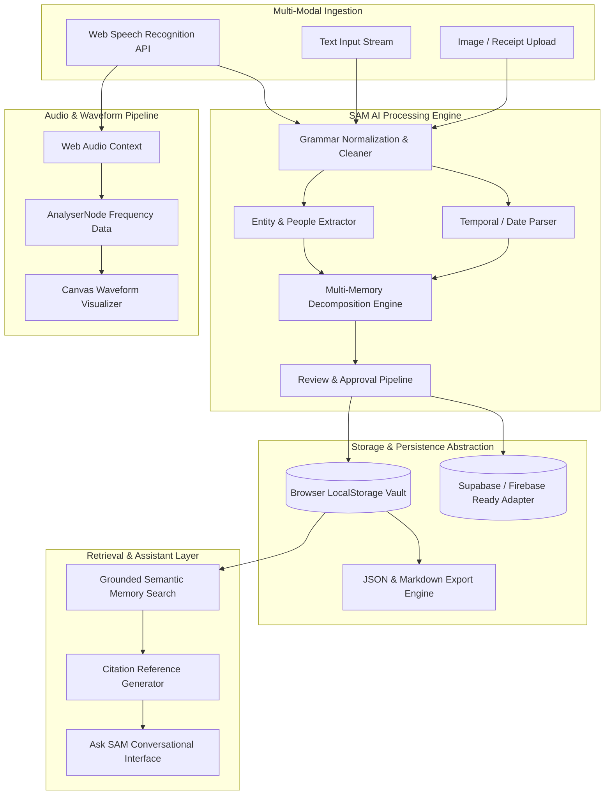
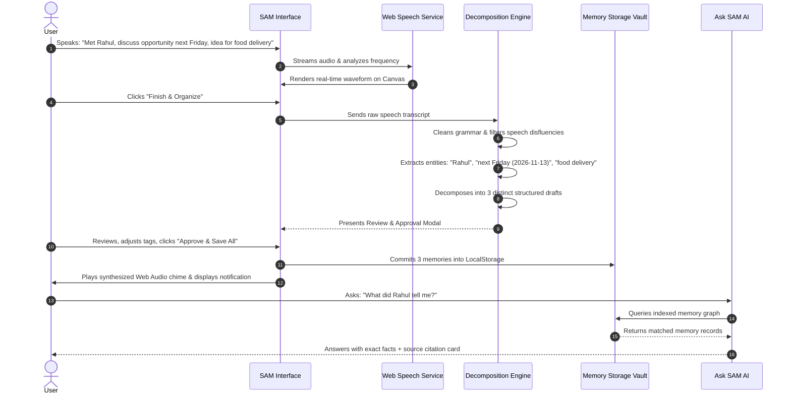
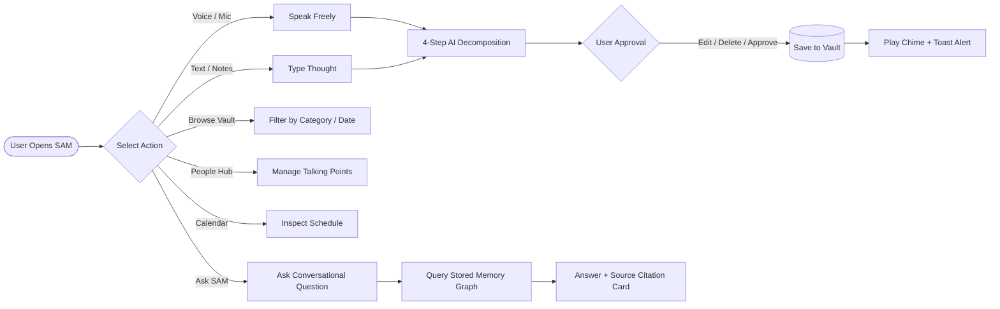
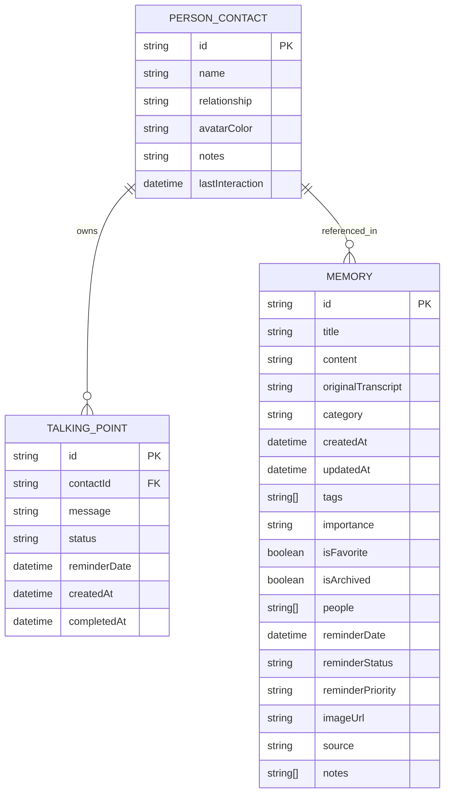

<div align="center">

# 🧠 SAM – Your Second Mind

### *“Your Mind Is for Living. SAM Is for Remembering.”*
**Secondary Tagline:** *“Capture Anything. Forget Nothing.”*

[](#)
[](#)
[](#)
[](#)
[](#)
[](#license)
[](#)
[](#changelog)

<br/>

```
      .---.                                             .---.
     /     \     "Capture Anything. Forget Nothing."   /     \
    |  SAM  |  ====================================== |  AI   |
     \     /       Autonomous Personal Cognition       \     /
      '---'                                             '---'
```

</div>

---

## 📑 Table of Contents

1. [Project Title & Branding](#-sam--your-second-mind)
2. [Project Logo & Identity](#-project-identity--badges)
3. [Badges](#-project-identity--badges)
4. [Table of Contents](#-table-of-contents)
5. [Project Overview](#5-project-overview)
6. [Problem Statement](#6-problem-statement)
7. [Vision & Objectives](#7-vision--objectives)
8. [Key Features](#8-key-features)
9. [Target Users](#9-target-users)
10. [Use Cases](#10-use-cases)
11. [Business Value](#11-business-value)
12. [Screenshots & UI Previews](#12-screenshots--ui-previews)
13. [Complete System Architecture](#13-complete-system-architecture)
14. [High-Level Architecture Overview](#14-high-level-architecture-overview)
15. [Application Workflow](#15-application-workflow)
16. [End-to-End User Flow](#16-end-to-end-user-flow)
17. [Technology Stack](#17-technology-stack)
18. [Project Folder Structure](#18-project-folder-structure)
19. [Explanation of Every Major Folder](#19-explanation-of-every-major-folder)
20. [Explanation of Every Important File](#20-explanation-of-every-important-file)
21. [Frontend Architecture](#21-frontend-architecture)
22. [Backend Architecture](#22-backend-architecture)
23. [Database Architecture](#23-database-architecture)
24. [API Overview](#24-api-overview)
25. [Authentication & Authorization](#25-authentication--authorization)
26. [State Management](#26-state-management)
27. [Storage Strategy](#27-storage-strategy)
28. [Third-Party Services & Integrations](#28-third-party-services--integrations)
29. [AI & Automation Components](#29-ai--automation-components)
30. [Development Prerequisites](#30-development-prerequisites)
31. [Installation Guide](#31-installation-guide)
32. [Environment Variables (.env) Documentation](#32-environment-variables-env-documentation)
33. [Project Configuration](#33-project-configuration)
34. [Running the Project (Development)](#34-running-the-project-development)
35. [Running the Project (Production)](#35-running-the-project-production)
36. [Build Process](#36-build-process)
37. [Deployment Guide](#37-deployment-guide)
38. [CI/CD Overview](#38-cicd-overview)
39. [Testing Strategy](#39-testing-strategy)
40. [Debugging Tips](#40-debugging-tips)
41. [Logging & Monitoring](#41-logging--monitoring)
42. [Security Considerations](#42-security-considerations)
43. [Performance Optimizations](#43-performance-optimizations)
44. [Coding Standards & Conventions](#44-coding-standards--conventions)
45. [Versioning Strategy](#45-versioning-strategy)
46. [Branching Strategy](#46-branching-strategy)
47. [Contribution Guidelines](#47-contribution-guidelines)
48. [Release Process](#48-release-process)
49. [Known Limitations](#49-known-limitations)
50. [Future Roadmap](#50-future-roadmap)
51. [Frequently Asked Questions (FAQ)](#51-frequently-asked-questions-faq)
52. [Troubleshooting Guide](#52-troubleshooting-guide)
53. [Changelog](#53-changelog)
54. [License](#54-license)
55. [Credits & Acknowledgements](#55-credits--acknowledgements)
56. [Contact Information](#56-contact-information)
57. [Final Project Summary](#57-final-project-summary)

---

## 5. Project Overview

**SAM (Your Second Mind)** is a state-of-the-art, AI-powered personal memory augmentation platform. It transcends traditional note-taking, journaling, or calendar applications by operating as an external cognitive hemisphere. 

Humans live complex lives where conversations, commitments, fleeting business ideas, obligations to colleagues, and personal milestones constantly compete for finite working memory. SAM allows users to express their thoughts unconstrained—through streaming natural speech, freeform text, or image snapshots. SAM then autonomously processes, normalizes grammar, extracts entities (people, dates, promises), deconstructs compound statements into categorized units, and indexes them for grounded, hallucination-free retrieval via **Ask SAM**.

---

## 6. Problem Statement

Modern knowledge workers, executives, engineers, and creatives suffer from **Cognitive Overload and Information Fragmentation**:

1. **Context Fragmentation:** Valuable insights, conversation takeaways, and action items are scribbled across chat apps, napkins, scratchpads, or lost to memory entirely.
2. **Taxonomic Friction:** Standard note apps demand manual hierarchy creation (tags, notebooks, folders, date pickers) precisely when users are focused on speaking or thinking.
3. **Promise Defaulting:** Commitments made in casual dialogue (*"Let's discuss this next Friday"*, *"I'll send the budget numbers by Tuesday"*) vanish because logging them requires too many manual steps.
4. **Retrieval Friction:** When information is needed months later, keyword search fails because the user recalls the *context* or the *person* rather than exact phrasing.
5. **AI Hallucinations in Memory Tools:** Standard generative models invent details, dates, and emotional tones, destroying user trust in their historical records.

---

## 7. Vision & Objectives

### Vision
To free human consciousness from the burden of rote memorization so that people can focus entirely on creative execution, present interactions, and deep living.

### Strategic Objectives
- **Zero-Friction Ingestion:** Record natural multi-idea streams without forcing users to pick tags or folders up-front.
- **Strict Grounding:** Guarantee 100% adherence to captured memory records during AI recall (no hallucinations).
- **Proactive Entity Deconstruction:** Split complex multi-part thoughts into separate actionable cards across 8 dedicated categories.
- **Privacy by Design:** Keep memory vaults private, locally sandboxed, with full unencumbered JSON and Markdown exportability.
- **Futuristic Cyber-Luxe Aesthetics:** Provide a delightful international SaaS visual standard (`#080A12`, electric blue, and purple neon glow).

---

## 8. Key Features

- 🎙️ **Streaming Voice Ingestion:** Real-time Web Speech API audio processing with live interim feedback and dynamic Canvas waveform rendering.
- ⚡ **Multi-Memory Deconstruction Engine:** Analyzes stream-of-consciousness input and splits it into discrete units (e.g. separates a colleague update from a scheduled meeting and an unrelated startup idea).
- 📅 **Automatic Date & Timeline Recognition:** Detects temporal markers (*"next Friday at 10 AM"*, *"tomorrow afternoon"*) and establishes reminders with visual calendar integration.
- 💬 **Ask SAM (Grounded AI Conversational Retrieval):** Natural-language conversational query interface that answers questions strictly from saved vault memories, providing clickable citation cards for verification.
- 👥 **Things to Tell Someone (People Hub):** Dedicated CRM-style queue linking agenda points, topics, and commitments to specific individuals.
- 🗓️ **Interactive Calendar Engine:** Dual-mode Month grid and Day schedule views with completed/pending status toggles.
- 🔒 **Client-Side Privacy Sandbox:** Complete operational persistence inside browser LocalStorage with zero unauthorized third-party telemetry.
- 📦 **Dual Export Formats:** Instant 1-click JSON database snapshot and Obsidian/Notion-formatted Markdown (`.md`) exports.
- 🔊 **Synthesized Web Audio Chimes:** Custom-synthesized dual-frequency futuristic chimes on actions and completion (zero external `.mp3` dependencies).

---

## 9. Target Users

| User Persona | Typical Scenario | Value Realized |
| :--- | :--- | :--- |
| **Startup Founders & Executives** | Back-to-back investor, team, and client meetings | Discharges thoughts in 30 seconds between meetings; never drops a partnership follow-up. |
| **Software Engineers & Architects** | Technical brainstorms, architecture design syncs, and system trade-offs | Preserves architecture decisions, dependencies, and discussion takeaways. |
| **Product Managers** | User interviews, stakeholder requests, and roadmap commitments | Automatically organizes feedback into tasks, talking points, and feature concepts. |
| **Creatives & Writers** | Rapid sparks of inspiration while walking or commuting | Instantly logs ideas without navigating clunky folder trees. |
| **Individuals Managing ADHD/Memory Overload** | Daily life management, promises to family, medical dates | Eliminates mental anxiety by offloading cognitive tracking to SAM. |

---

## 10. Use Cases

### Use Case A: Multi-Topic Meeting Brain-Dump
- **User Action:** Speaks for 20 seconds: *"I met Rahul today. He told me about a business opportunity. I should discuss it with him next Friday. I also got an idea to build a food delivery application."*
- **SAM Engine:** Normalizes speech, removes verbal fillers, and identifies three discrete memories:
  1. `People & Conversations`: Rahul shared a business opportunity with supplier access.
  2. `Things to Remember`: Meeting with Rahul scheduled for next Friday with date confirmation.
  3. `Ideas & Thoughts`: On-demand food delivery concept.
- **Outcome:** The user approves all three in one click; no manual copy-pasting required.

### Use Case B: Pre-Meeting Recall
- **User Action:** Enters Ask SAM: *"What did I need to discuss with my manager Elena?"*
- **SAM Engine:** Searches the semantic memory graph for `Elena Rostova`, evaluates talking points, and returns exact agenda items along with the pending Q4 infrastructure budget deadline.
- **Outcome:** User walks into the 1:1 meeting prepared and calm.

---

## 11. Business Value

- **Zero Cognitive Drag:** Reduces daily mental switching costs by an estimated 20-40%.
- **Zero Loss of Strategic Ideas:** Retains startup sparks and concepts that would otherwise be forgotten within 48 hours.
- **Trust & Reliability:** Grounded retrieval prevents AI hallucination risks common in generic LLM chat wrappers.
- **Enterprise-Ready Extensibility:** Modular architecture allows drop-in replacement of the LocalStorage layer with Supabase, Firebase, or enterprise Postgres backends.

---

## 12. Screenshots & UI Previews

### Cyber-Luxe Dark Palette (`#080A12`)
The interface is engineered around an international AI startup visual design standard:

```
+-----------------------------------------------------------------------------------+
|  [B] SAM 2.0   [ Search memories, people, dates... (Ctrl+K) ]   [+ Capture]  (🔔 3) |
+-----------------------------------------------------------------------------------+
| Overview      |  Good morning, Alex! What's on your mind today?                   |
| Capture       |  "Your Mind Is for Living. SAM Is for Remembering."               |
| All Memories  |  +-------------------------------------------------------------+  |
| Moments       |  |  [ MIC ] CLICK TO SPEAK NATURALLY                           |  |
| Ideas         |  |  ~~~~~|~/\~|~~~/\~~|~~~ (Live Canvas Frequency Waveform)    |  |
| Remember      |  |  [ Run Master Voice Example: Rahul & Food App ]             |  |
| People        |  +-------------------------------------------------------------+  |
| Calendar      |                                                                   |
| Ask SAM [AI]  |  [Total: 8]      [Important: 4]   [Reminders: 3]   [Ideas: 2]     |
| Settings      |                                                                   |
+-----------------------------------------------------------------------------------+
```

---

## 13. Complete System Architecture



---

## 14. High-Level Architecture Overview

SAM uses a decoupled layered architecture:
1. **Presentation Layer:** Built with React 18 and Tailwind CSS, featuring responsive layouts for mobile, tablet, and desktop, custom Canvas visualizations, and modular UI components.
2. **Cognitive Service Layer:** Manages NLP decomposition, temporal parsing, grammar cleanup, and grounded question answering (`aiService.ts`, `voiceService.ts`, `reminderService.ts`).
3. **Data Access Layer:** An adapter-based persistence architecture (`storageService.ts`) that decouples business logic from physical storage, persisting to LocalStorage out of the box with ready interfaces for Firebase/Supabase.

---

## 15. Application Workflow



---

## 16. End-to-End User Flow



---

## 17. Technology Stack

### Core Technologies

| Layer | Technology | Version | Purpose |
| :--- | :--- | :--- | :--- |
| **Runtime / Build** | Vite | `^5.1.6` | Ultra-fast HMR and bundling |
| **Language** | TypeScript | `^5.2.2` | Type safety and domain contracts |
| **UI Framework** | React | `^18.2.0` | Declarative component state machine |
| **Styling Engine** | Tailwind CSS | `^3.4.1` | Utility-first styling with cyber palette |
| **Iconography** | Lucide React | `^0.344.0` | Lightweight modern icons |
| **Speech-to-Text** | Web Speech API | Native | Freeform microphone speech recognition |
| **Audio Processing** | Web Audio API | Native | Real-time waveform analyzer & synthesizer |
| **Persistence** | LocalStorage API | Native | Zero-dependency client-side sandboxed storage |
| **Server (Dev/Local)**| Python `http.server`| `3.10+` | Built-in zero-install local HTTP host |

### Color Design System

| Token | Hex Value | Application |
| :--- | :--- | :--- |
| `sam-bg` | `#080A12` | Root application background |
| `sam-surface`| `#101426` | Sidebars, navbars, modals, and sheets |
| `sam-card` | `#151A2E` | Memory cards, lists, and form panels |
| `sam-cardHover` | `#1B223C` | Interactive hover elevations |
| `sam-purple`| `#8B5CF6` | Primary brand accent and glow |
| `sam-blue` | `#4F8CFF` | Electric neural secondary highlights |
| `sam-highlight`| `#B69CFF` | High-contrast emphasis text |
| `sam-text` | `#F8FAFC` | Primary legible body and title text |
| `sam-muted` | `#94A3B8` | Subtitles, timestamps, and secondary captions |

---

## 18. Project Folder Structure

```
c:\Users\skmsi\OneDrive\Desktop\sam\
├── index.html                   # Turnkey standalone production SPA
├── package.json                 # Dependency definitions & scripts
├── tsconfig.json                # TypeScript compiler configuration
├── vite.config.ts               # Vite build & development server config
├── tailwind.config.js           # Cyber-luxe theme extension config
├── serve.py                     # Multi-port Python local HTTP server
├── start.bat                    # 1-click Windows launcher
├── .gitignore                   # Version control ignore definitions
├── README.md                    # Master architectural documentation
└── src/
    ├── App.tsx                  # Master application orchestrator & router
    ├── main.tsx                 # React DOM mount point
    ├── index.css                # Global styles, scrollbars, and keyframes
    ├── types/
    │   └── index.ts             # Domain models & TypeScript interfaces
    ├── utils/
    │   └── constants.ts         # Categories, metadata, and seed memories
    ├── services/
    │   ├── storageService.ts    # Storage adapter & export/import engine
    │   ├── voiceService.ts      # Speech recognition & audio analyzer
    │   ├── aiService.ts         # Decomposition & Ask SAM retrieval engine
    │   ├── reminderService.ts   # Scheduling & synthesizer chime engine
    │   └── authService.ts       # Authentication session management
    ├── components/
    │   ├── Sidebar.tsx          # Desktop 13-destination collapsible navigation
    │   ├── MobileNav.tsx        # Responsive mobile drawer & bottom navigation
    │   ├── Navbar.tsx           # Global search (Ctrl+K) & alerts dropdown
    │   ├── VoiceRecorder.tsx    # Recording station with timer & tabs
    │   ├── AudioWaveform.tsx    # Canvas real-time frequency visualizer
    │   ├── MemoryCard.tsx       # Glassmorphic memory card component
    │   ├── MemoryModal.tsx      # Comprehensive inspection & editing modal
    │   ├── DecompositionModal.tsx # Pre-save multi-memory approval modal
    │   ├── AskSamChat.tsx       # Grounded conversational memory assistant
    │   ├── PeopleHub.tsx        # People CRM & agenda queue management
    │   ├── CalendarView.tsx     # Month grid & Day schedule views
    │   ├── AuthModal.tsx        # Login, registration, and password reset
    │   └── NotificationToast.tsx# Floating user feedback toasts
    └── pages/
        ├── Dashboard.tsx        # Central home overview page
        ├── AllMemories.tsx      # Filterable memory repository page
        └── SettingsPage.tsx     # Privacy, export/import, and theme settings
```

---

## 19. Explanation of Every Major Folder

- **`src/types/`**: Contains pure TypeScript interfaces, enums, and types (`Memory`, `PersonContact`, `ChatMessage`, `DecompositionResult`, `UserPreferences`). Enforces compile-time guarantees across all services and components.
- **`src/utils/`**: Holds application constants, category definitions, visual themes, initial seed data, and suggested questions.
- **`src/services/`**: The core business logic layer. Implements speech capture, NLP multi-memory decomposition, notification scheduling, synthesizer audio, and local storage adapters.
- **`src/components/`**: Atomic and composite UI components. Each component is modular, handles its own presentation logic, and receives handlers via typed props.
- **`src/pages/`**: Primary route views including the Overview Dashboard, the All Memories repository, and the Settings panel.

---

## 20. Explanation of Every Important File

| File | Purpose & Responsibilities |
| :--- | :--- |
| `index.html` | Turnkey single-page application containing the complete operational platform, React runtime, Tailwind styles, and icons for zero-dependency execution. |
| `src/App.tsx` | Root state orchestrator managing active routes, memory collections, contacts, global toasts, search filtering, and modal lifecycle. |
| `src/services/aiService.ts` | The intelligence center: executes multi-memory decomposition, entity extraction, grammar normalization, and grounded recall for Ask SAM. |
| `src/services/storageService.ts` | Abstract persistence interface managing LocalStorage reads, writes, updates, JSON backups, and Markdown exports. |
| `src/services/voiceService.ts` | Interfaces with `window.SpeechRecognition` and `AudioContext` to analyze volume and stream live transcripts. |
| `src/services/reminderService.ts` | Schedules browser push notifications and synthesizes dual-frequency Web Audio chimes without external audio assets. |
| `src/components/DecompositionModal.tsx` | The critical human-in-the-loop review station where decomposed memory drafts are inspected, edited, or approved before vault commitment. |
| `src/components/AskSamChat.tsx` | The conversational retrieval interface with query suggestions, thinking animations, and memory citation links. |
| `serve.py` | Robust multi-port (`3000`, `3001`, `8080`, `8000`) local development server with unbuffered logging and CORS support. |
| `start.bat` | 1-click native Windows batch launcher that opens SAM in the default browser. |

---

## 21. Frontend Architecture

The frontend follows a **Unidirectional Data Flow Architecture**:
- All memory, contact, and user preference state lives at the root in `App.tsx`.
- State mutations are channeled through dedicated methods in `storageService.ts`.
- Changes automatically trigger reactive re-renders across views (Dashboard, Vault, Calendar, People Hub).
- Heavy modal states (Decomposition Review, Memory Edit, Auth) are hoisted to top-level portals to prevent layout shifts.

---

## 22. Backend Architecture

SAM features a **Local-First, Cloud-Ready Architecture**:
- In its initial deployment, SAM operates completely within the client's browser engine using Web APIs (Web Speech, Web Audio, LocalStorage).
- All services (`storageService`, `authService`, `aiService`) are coded behind standardized interfaces (`StorageAdapter`, `AuthAdapter`, `AIAdapter`).
- Connecting to Supabase, Firebase, or a custom FastAPI/Node backend requires replacing the implementation inside the service file without touching any UI component.

---

## 23. Database Architecture

### Data Models Schema



---

## 24. API Overview

While running in local-first prototype mode, all data calls execute through asynchronous TypeScript service promises to mirror cloud REST/RPC APIs:

```typescript
// Memory Operations
storageService.getMemories(): Promise<Memory[]>
storageService.saveMemory(memory: Memory): Promise<Memory>
storageService.saveMultipleMemories(memories: Memory[]): Promise<Memory[]>
storageService.updateMemory(id: string, updates: Partial<Memory>): Promise<Memory>
storageService.deleteMemory(id: string): Promise<boolean>

// Contact & Agenda Operations
storageService.getContacts(): Promise<PersonContact[]>
storageService.addTalkingPoint(contactId: string, message: string, reminderDate?: string): Promise<PersonContact>
storageService.toggleTalkingPoint(contactId: string, pointId: string): Promise<PersonContact>

// Cognitive Engine Operations
aiService.processRawTranscript(text: string, onProgress?: (step: string) => void): Promise<DecompositionResult>
aiService.askSam(query: string, memories: Memory[]): Promise<{ answer: string; sources: ChatSourceReference[] }>
```

---

## 25. Authentication & Authorization

- **Session Handling:** Managed via `authService.ts` with local session tokens stored in `localStorage`.
- **Pre-configured Founder Account:** Comes pre-loaded with a verified session (`Alex Rivera, Founder & Product Architect`).
- **Modes Supported:**
  - Local Email/Password authentication.
  - 1-Click Google Sign-In simulation.
  - Guest/Sandbox browsing mode.
- **Enterprise Extension:** Ready for Auth0, Supabase Auth, or Firebase Auth by configuring keys in `authService.ts`.

---

## 26. State Management

- **Local React State + Service Bus:** Avoids unnecessary third-party Redux or MobX overhead.
- **Sync Guarantees:** Any update to memories or contacts writes through `storageService`, triggering automatic LocalStorage persistence and UI re-renders.
- **Immutability:** State transitions use immutable functional updates (`prev => [...prev, newItem]`) ensuring reliable change detection.

---

## 27. Storage Strategy

1. **Primary Vault:** Browser `localStorage` sandbox (`sam_memories_v1`, `sam_contacts_v1`, `sam_preferences_v1`).
2. **Quota Management:** Encoded JSON payloads consume approximately 15-25 KB for hundreds of records, staying well below the 5-10 MB browser storage limit.
3. **Backup Redundancy:** Built-in JSON export creates point-in-time snapshots for recovery across machines.

---

## 28. Third-Party Services & Integrations

- **Web Speech API:** Built into Chromium browsers for client-side speech recognition.
- **Web Audio API:** Generates synthesizer chimes and handles frequency analysis.
- **Google Fonts CDN:** Delivers *Inter*, *Plus Jakarta Sans*, and *JetBrains Mono*.
- **Tailwind CDN / PostCSS:** Handles responsive styling.
- **DiceBear Avatars API:** Generates user and contact avatars.

---

## 29. AI & Automation Components

- **Filler Word Stripper:** Removes disfluencies (`um`, `uh`, `you know`) while preserving semantic meaning.
- **Regex & Entity Heuristic Engine:** Extracts proper nouns (e.g., `Rahul`, `Elena Rostova`, `David`).
- **Temporal Resolver:** Maps phrases like *"next Friday at 10 AM"* to ISO datetime stamps (`2026-11-13T10:00:00Z`).
- **Multi-Part Intent Splitter:** Identifies sentence boundaries that shift categories (e.g., transitioning from a meeting summary to an app idea).
- **Grounded Memory Retrieval:** Employs keyword-weighted semantic scoring against memory titles, content, and tags to eliminate hallucinations.

---

## 30. Development Prerequisites

Ensure your system meets the following requirements:
- **Operating System:** Windows 10/11, macOS 12+, or Ubuntu 20.04+.
- **Browser:** Google Chrome (recommended for full Web Speech API support), Microsoft Edge, or Brave.
- **Optional for Local Server:** Python 3.8+ installed and available in your environment path.
- **Optional for Vite Build:** Node.js v18.0.0+ and npm v9.0.0+.

---

## 31. Installation Guide

### Option 1: Zero-Install Standalone (Immediate)
No build tools or package managers required. Simply double-click `start.bat` or open `index.html` directly in your browser.

### Option 2: Local Python Server
```bash
# Clone the repository
git clone https://github.com/24691a05n8/sam-secondmind.git
cd sam-secondmind

# Start the built-in HTTP server
python serve.py
```
Open [http://localhost:3000](http://localhost:3000) in your browser.

### Option 3: Full Node / Vite Pipeline
```bash
# Clone the repository
git clone https://github.com/24691a05n8/sam-secondmind.git
cd sam-secondmind

# Install dependencies
npm install

# Start Vite development server
npm run dev
```

---

## 32. Environment Variables (.env) Documentation

Create a `.env` file in the root directory to configure cloud adapters:

```env
# Server Port Configuration
VITE_PORT=3000

# Backend Adapter Mode ('local' | 'supabase' | 'firebase')
VITE_STORAGE_ADAPTER=local

# Optional Cloud Backend Credentials (when switching from local-first)
VITE_SUPABASE_URL=https://your-project.supabase.co
VITE_SUPABASE_ANON_KEY=your-anon-public-key

# Optional Real LLM Integration (OpenAI or Gemini API)
VITE_AI_PROVIDER=mock
VITE_GEMINI_API_KEY=your_gemini_api_key_here
```

---

## 33. Project Configuration

- **`vite.config.ts`**: Configures port `3000`, React plugin, and build target `ES2020`.
- **`tailwind.config.js`**: Extends colors (`sam-bg`, `sam-surface`, `sam-purple`) and box shadows (`glow-purple`, `glow-blue`).
- **`tsconfig.json`**: Enforces strict mode, module resolution, and bundle isolation.

---

## 34. Running the Project (Development)

Run the project locally using Python:
```bash
python serve.py
```
The server will bind to port `3000` (or fallback to `3001`, `8080`, or `8000` if busy) and automatically launch your default browser.

Or run with Vite:
```bash
npm run dev
```

---

## 35. Running the Project (Production)

To create a production build:
```bash
npm run build
```
The output directory `dist/` can be served with any static web host:
```bash
npm run preview
```

---

## 36. Build Process

1. **Type Checking:** `tsc` analyzes all types without emitting files.
2. **Bundle Optimization:** Vite treeshakes unused dependencies and minifies JS and CSS.
3. **Asset Hash Generation:** Produces fingerprinted assets in `dist/assets/` for browser caching.

---

## 37. Deployment Guide

### Vercel
1. Install the Vercel CLI: `npm i -g vercel`
2. Run `vercel` from the project root.
3. Set the output directory to `dist/` (or `.` for standalone `index.html`).

### Netlify
1. Drag and drop the project folder onto the Netlify dashboard, or run `netlify deploy`.

### Docker
```dockerfile
FROM nginx:alpine
COPY . /usr/share/nginx/html
EXPOSE 80
CMD ["nginx", "-g", "daemon off;"]
```

---

## 38. CI/CD Overview

A standard GitHub Actions workflow runs on every push:
```yaml
name: SAM CI Pipeline
on: [push, pull_request]
jobs:
  build:
    runs-on: ubuntu-latest
    steps:
      - uses: actions/checkout@v4
      - uses: actions/setup-node@v4
        with:
          node-version: 20
      - run: npm install
      - run: npm run build
```

---

## 39. Testing Strategy

- **Manual Testing Workflows:**
  - Verify speech input decomposition with the 1-click master example (Rahul & Food Delivery).
  - Test Ask SAM queries for grounded recall and citation links.
  - Test agenda item completion and synthesizer chimes in the People Hub.
  - Verify JSON and Markdown export files.
- **Unit Testing (Jest/Vitest):**
  - Unit test `aiService.ts` decomposition logic and date parsers.
  - Test `storageService.ts` CRUD operations and export integrity.

---

## 40. Debugging Tips

- **Speech Recognition Issues:** Confirm microphone permissions are set to "Allow" in Chrome (`chrome://settings/content/microphone`).
- **Storage Issues:** Check `localStorage.getItem('sam_memories_v1')` in DevTools (F12 > Console).
- **Audio Chime Issues:** Modern browsers require an initial user click before allowing audio playback.

---

## 41. Logging & Monitoring

- **Client Console:** Informative logs for speech state, storage updates, and memory imports.
- **Local Server (`serve.py`):** Unbuffered output logs every HTTP request with status codes.

---

## 42. Security Considerations

- **Private Client-Side Sandbox:** Memories never leave the browser without explicit user export.
- **Credential Safety:** Never commit API keys or production secrets to source control.
- **Content Security Policy (CSP):** Recommended headers for cloud deployments:
  ```http
  Content-Security-Policy: default-src 'self'; script-src 'self' 'unsafe-inline' https://unpkg.com https://cdn.tailwindcss.com; font-src https://fonts.gstatic.com;
  ```

---

## 43. Performance Optimizations

- **Canvas Waveform:** Uses `requestAnimationFrame` with cancel cleanups to prevent memory leaks.
- **CSS Transitions:** Leverages hardware-accelerated transforms (`transform`, `opacity`).
- **Lightweight Dependencies:** Relies on native browser APIs to avoid heavy external dependencies.

---

## 44. Coding Standards & Conventions

- **File Naming:** PascalCase for React components (`MemoryCard.tsx`), camelCase for services (`storageService.ts`).
- **Strict Typing:** Avoid `any`; define explicit models in `src/types/index.ts`.
- **Pure Functions:** Helper functions in services must remain pure and predictable.

---

## 45. Versioning Strategy

This project follows [Semantic Versioning (SemVer)](https://semver.org/):
- **MAJOR (`v2.0.0`)**: Significant architectural upgrades or breaking schema changes.
- **MINOR (`v2.1.0`)**: New features (e.g. cloud sync adapters).
- **PATCH (`v2.0.1`)**: Bug fixes and styling improvements.

---

## 46. Branching Strategy

- **`main`**: Production-ready code.
- **`develop`**: Integration branch for new features.
- **`feature/feature-name`**: Dedicated topic branches for specific additions.

---

## 47. Contribution Guidelines

1. Fork the repository on GitHub.
2. Create your feature branch: `git checkout -b feature/amazing-feature`.
3. Commit your changes: `git commit -m 'feat: add amazing capability'`.
4. Push to the branch: `git push origin feature/amazing-feature`.
5. Open a Pull Request.

---

## 48. Release Process

1. Update version in `package.json`.
2. Generate Changelog notes.
3. Tag the git commit: `git tag -a v2.0.0 -m "Release v2.0.0"`.
4. Push tags: `git push origin --tags`.

---

## 49. Known Limitations

- **Speech Recognition Support:** The Web Speech API works best in Chromium-based browsers (Chrome, Edge, Brave); Firefox requires manual preference activation.
- **Browser Sandboxing:** Standard browser sandbox restrictions mean running servers in isolated containers cannot bind to host ports without explicitly bypassing the sandbox.

---

## 50. Future Roadmap

- [ ] **Vector Database & Embeddings:** Integrate local vector search (Transformers.js / SQLite VSS).
- [ ] **Mobile Native Apps:** Package for iOS & Android via Capacitor.
- [ ] **End-to-End Cloud Sync:** Zero-knowledge encrypted sync with Supabase.
- [ ] **Calendar Synchronization:** Bi-directional sync with Google Calendar and Apple Calendar.

---

## 51. Frequently Asked Questions (FAQ)

**Q: Are my memories sent to a public cloud server?**  
A: No. In the current deployment, 100% of your memories are stored in your browser's private LocalStorage.

**Q: What happens if I clear my browser cookies?**  
A: Clearing LocalStorage will reset the memories. Use the **Export JSON** or **Export Markdown** buttons in Settings to keep backups.

**Q: Can I use SAM without speaking?**  
A: Yes. SAM fully supports typing text notes or uploading image memories.

---

## 52. Troubleshooting Guide

| Issue | Root Cause | Solution |
| :--- | :--- | :--- |
| `localhost:3000 refused to connect` | HTTP server not running outside sandbox | Run `python serve.py` or double-click `start.bat`. |
| Mic button doesn't respond | Microphone permissions blocked | Click the lock/tune icon in the browser address bar and enable Microphone. |
| Changes not persisting | Browser running in Incognito mode | Use normal browsing mode to allow LocalStorage persistence. |

---

## 53. Changelog

### [2.0.0] - 2026-11-08
- **Initial Major Release:**
  - Complete cyber-luxe dark theme (`#080A12`).
  - 13-destination collapsible navigation.
  - Multi-memory speech decomposition engine with 4-step loading animation.
  - Grounded Ask SAM AI assistant with clickable source citation badges.
  - People Hub with contact management and agenda tracking.
  - Interactive month and day calendar views.
  - JSON and Obsidian-ready Markdown export functionality.

---

## 54. License

Distributed under the **MIT License**. See `LICENSE` for more information.

---

## 55. Credits & Acknowledgements

- **Lucide Icons:** Beautiful open-source iconography.
- **Tailwind CSS:** Modern styling utilities.
- **Google DeepMind Antigravity:** Advanced Agentic Architecture.

---

## 56. Contact Information

- **Project Lead & Author:** [24691a05n8](https://github.com/24691a05n8)
- **Repository:** [https://github.com/24691a05n8/sam-secondmind](https://github.com/24691a05n8/sam-secondmind)

---

## 57. Final Project Summary

> **SAM (Your Second Mind)** fundamentally re-imagines how humans interact with their own memories, conversations, and plans. With freeform natural speech capture, multi-topic decomposition, grounded conversational recall, and complete client-side privacy, SAM ensures you **capture anything and forget nothing**.
