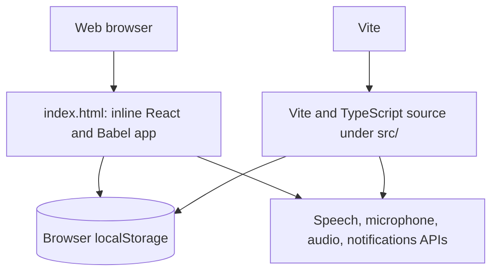
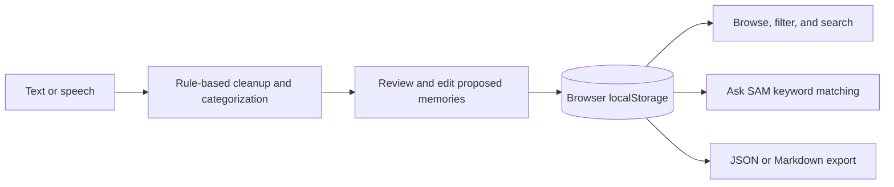

# SAM: Your Second Mind

SAM is a browser-based personal memory organizer for capturing notes, organizing them into categories, tracking people and follow-ups, and searching saved records. The repository currently contains a standalone browser application and a separate React/TypeScript source implementation; they are not yet connected to the same entry point.

[](https://react.dev/)
[](https://www.typescriptlang.org/)
[](https://vite.dev/)
[](https://tailwindcss.com/)

> Status: prototype. There is no verified release, license file, automated test suite, or CI workflow in this repository.

## Contents

- [Overview](#overview)
- [Features and intended users](#features-and-intended-users)
- [Screenshots](#screenshots)
- [Architecture](#architecture)
- [Technology](#technology)
- [Repository layout](#repository-layout)
- [Setup and development](#setup-and-development)
- [Configuration and data](#configuration-and-data)
- [Security and privacy](#security-and-privacy)
- [Testing and operations](#testing-and-operations)
- [Contributing and releases](#contributing-and-releases)
- [Limitations and roadmap](#limitations-and-roadmap)
- [FAQ and troubleshooting](#faq-and-troubleshooting)
- [Changelog](#changelog)
- [License and contact](#license-and-contact)

## Overview

SAM is intended to reduce the effort of keeping personal notes, conversation details, ideas, and commitments in one place. Users can capture text or speech, review categorized memory drafts, browse or search saved memories, keep contact-specific talking points, and view reminders in a calendar-oriented interface.

The current application is a local-first prototype. It stores records in the browser's `localStorage`; it does not have a server, shared database, cloud synchronization, or production AI provider. The default `index.html` is a standalone implementation with sample data. The TypeScript application under `src/` is a separate implementation and is not currently loaded by the root HTML entry point.

### Problem and vision

Personal notes, ideas, and follow-ups are easy to lose across conversations and tools. SAM explores a lightweight personal vault that makes it easier to capture information and find it again without requiring a hosted account or backend.

The project aims to provide quick capture, categorization, reminder visibility, and convenient exports. These are prototype goals, not service-level guarantees.

### Intended users and use cases

SAM may be useful to individuals who want a personal place for meeting notes, ideas, tasks, important dates, and things to discuss with specific people. Example workflows include recording a thought, reviewing and saving the suggested memory cards, checking a contact's talking points before a conversation, and exporting a local backup.

The potential value is reduced context switching and easier recall. No measured business outcomes or productivity improvements are currently available.

## Features and intended users

The root standalone application and the TypeScript source include overlapping prototype features. Availability and details can differ between the two implementations.

| Capability | Current implementation |
| --- | --- |
| Memory capture | Text entry and browser speech recognition where supported |
| Organization | Eight categories, tags, importance, favorites, archive, and editable memory details |
| Draft organization | Rule-based transcript cleanup, categorization, and decomposition, followed by user review |
| Ask SAM | Query matching and canned responses over locally available memory records; not an LLM or embedding search |
| Contacts | Contact records and person-specific talking points |
| Calendar and reminders | Calendar views and reminder dates stored with memories; no reliable background scheduler |
| Data management | JSON backup/import and Markdown export in the TypeScript settings implementation |
| Preferences | Local profile, theme, sound, and notification preferences in the TypeScript implementation |
| Audio | Browser microphone level visualization and synthesized Web Audio chimes where supported |

## Screenshots

No screenshots or maintained image assets are currently included. Add reviewed screenshots under a dedicated documentation or assets directory when available.

## Architecture

### High-level architecture and entry points



The default launcher (`start.bat`), the Python server (`serve.py`), and the Vite HTML entry all serve the root `index.html`. That file contains inline application code and loads React, ReactDOM, Babel, Tailwind CSS, and fonts from CDNs. It does not import `src/main.tsx`. The `src/` tree is a separate React/TypeScript implementation; wiring it into the default app is not yet configured.

There is no backend service or remote application API in the repository. The services in `src/services/` are browser-side modules. The root standalone implementation has its own inline code and should not be assumed to share the TypeScript service implementation.

### Application workflow



In the TypeScript source, `App.tsx` owns top-level UI state and connects pages and components to browser services. Capture drafts are reviewed before saving. Search and Ask SAM operate on records already available in the browser. The AI service uses heuristics, special-case sample responses, and keyword matching; it does not call an AI model.

### Frontend and state management

The root standalone page maintains its UI state inside its inline application. In the separate TypeScript implementation, React state is primarily owned by `src/App.tsx` and passed to pages and components through props. There is no global state-management library. The source UI calls browser-side services to load and persist data.

### Backend and API overview

There is no backend server, public HTTP API, or remote API contract. The TypeScript application exposes asynchronous browser-side service methods, including memory and contact operations in `storageService.ts`, transcript processing and `askSam` in `aiService.ts`, and browser speech functions in `voiceService.ts`. These are internal modules, not network endpoints. The root standalone page has a separate inline implementation.

### Data model and storage

The TypeScript domain types in `src/types/index.ts` describe memories, contacts, talking points, chat messages, decomposition drafts, and preferences. The storage service persists JSON in browser storage under these keys:

| Data | `localStorage` key |
| --- | --- |
| Memories | `sam_memories_v1` |
| Contacts and talking points | `sam_contacts_v1` |
| Preferences | `sam_preferences_v1` |
| Auth demo session | `sam_auth_user_session` |

There is no relational database, schema migration system, cross-device sync, or server-side backup. Browser data is scoped to the browser profile and origin. Import/export behavior should be tested before relying on backups.

### Authentication and authorization

The TypeScript `authService.ts` simulates local sign-in and a Google sign-in flow, storing a profile-like session in `localStorage`. It does not verify passwords, perform OAuth, or protect data on a server. It is not production authentication or authorization. The standalone app may present its own demo UI; do not treat either implementation as a security boundary.

### Integrations and browser APIs

- Web Speech API / `webkitSpeechRecognition` for supported browser speech input. Browser vendors may process speech according to their own implementation and policies.
- `getUserMedia`, Web Audio API, and Canvas-based visualization for microphone input and sound features where available.
- Browser Notifications API for permission-based system notifications; the app does not provide a dependable background reminder service.
- CDN-hosted libraries, fonts, and remote avatar URLs in the standalone HTML and sample data.

No cloud database, payment provider, analytics platform, external LLM, or production identity provider is configured.

## Technology

| Area | Technology |
| --- | --- |
| Standalone entry | Inline React 18 UMD, Babel Standalone, Tailwind CDN |
| Source implementation | React 18, TypeScript 5.2, Lucide React |
| Build tooling | Vite 5, TypeScript, Tailwind CSS 3, PostCSS-related packages |
| Persistence | Browser `localStorage` |
| Local static server | Python standard-library HTTP server (`serve.py`) |

Dependency versions are declared in `package.json`. The standalone HTML also loads several browser dependencies from CDNs at runtime.

## Repository layout

```text
.
├── index.html                 # Standalone inline app and Vite HTML entry
├── package.json               # Dependencies and npm scripts
├── vite.config.ts             # Vite development server configuration
├── tsconfig.json              # Strict TypeScript compiler settings
├── tailwind.config.js         # Tailwind theme and content paths
├── serve.py                   # Python static server for the root HTML app
├── start.bat                  # Opens index.html directly in a browser
├── push_to_github.bat         # Repository helper script
└── src/
    ├── App.tsx                # TypeScript app state and view composition
    ├── main.tsx               # React DOM mount point (not referenced by index.html)
    ├── index.css              # Tailwind directives and global styles
    ├── components/            # Navigation, capture, memory, calendar, and modal UI
    ├── pages/                 # Dashboard, memory list, and settings views
    ├── services/              # Browser storage, auth demo, voice, AI heuristics, reminders
    ├── types/                 # Shared TypeScript domain types
    └── utils/                 # Categories and demo/initial data
```

### Major folders and files

| Path | Responsibility |
| --- | --- |
| `src/components/` | Reusable interface modules: navigation, voice capture, waveform, memory editing, decomposition review, Ask SAM, People Hub, calendar, auth modal, and notifications. |
| `src/pages/` | Dashboard, all-memories browsing, and settings views. |
| `src/services/storageService.ts` | `localStorage` CRUD, demo reset, import, and JSON/Markdown exports. |
| `src/services/aiService.ts` | Deterministic heuristics for draft decomposition and local query matching. |
| `src/services/voiceService.ts` | Browser speech-recognition and microphone-level integration. |
| `src/services/reminderService.ts` | Notification permission checks, relative date formatting, and Web Audio chimes. |
| `src/services/authService.ts` | Demo profile/session behavior stored in the browser. |
| `src/types/index.ts` | Contracts for memory, contact, preferences, and chat data. |
| `src/utils/constants.ts` | Category metadata and initial demo content. |
| `src/App.tsx` | Root state, service calls, and selection of application views. |
| `src/main.tsx` | React mount point for the source implementation. |
| `index.html` | Self-contained standalone application; currently the default served page. |
| `package.json` | Dependency declarations and `dev`, `build`, and `preview` scripts. |
| `serve.py` | Static server that tries ports 3000, 3001, 8080, and 8000. |
| `start.bat` | Opens the standalone HTML file directly; it does not start Vite or Python. |

## Setup and development

### Prerequisites

- Node.js and npm for the Vite commands. Use a currently supported Node.js LTS release.
- Python 3 for the optional `serve.py` static server.
- A modern browser. Chromium-based browsers generally provide the broadest support for the Web Speech API.
- Microphone access and a secure context (typically `localhost` or HTTPS) for speech and microphone features.

### Install and run

Clone the repository and install npm dependencies:

```bash
git clone https://github.com/24691a05n8/sam-secondmind.git
cd sam-secondmind
npm install
```

Run the configured Vite development server:

```bash
npm run dev
```

The server is configured for port `3000` and opens a browser. The served entry is the standalone root `index.html`, not `src/main.tsx`.

To serve that same root HTML using Python instead:

```bash
python serve.py
```

Open the URL printed by the server. It tries ports `3000`, `3001`, `8080`, and `8000`. `start.bat` simply opens `index.html` as a local file; browser features that require a secure context or origin may not work in that mode.

### Environment variables and configuration

No `.env` variables are read by the application or declared in the Vite configuration. Supabase, Firebase, and AI provider settings are not implemented. Do not put secrets in frontend environment variables.

`vite.config.ts` sets the React plugin, development port, and automatic browser opening. `tsconfig.json` enables strict type checking and no output. `tailwind.config.js` defines theme tokens and source scanning. The standalone HTML separately configures its CDN-loaded Tailwind runtime.

### Build and production preview

```bash
npm run build
npm run preview
```

The build script runs `tsc` and then `vite build`; Vite uses the root HTML file as its entry point. The build output is `dist/` and can be served as static files. `npm run preview` serves the built output locally. No hosting provider configuration, deployment manifest, Dockerfile, or production environment is included in the repository; choose a static host and configure it to publish `dist/` if deploying.

The standalone HTML loads runtime libraries, styling, and fonts from third-party CDNs, so the default experience is not fully offline and those requests are subject to the providers' availability and policies.

## Security and privacy

- Memories, contacts, and preferences are stored in browser `localStorage` for the current origin and browser profile; anyone with access to that browser profile may be able to access them.
- There is no encryption-at-rest implementation, server-side access control, account verification, or secure multi-user isolation.
- Exported JSON and Markdown files are readable copies. Store and share them with appropriate care.
- Speech recognition behavior depends on the browser. Review the browser's privacy documentation before using sensitive information with speech input.
- The standalone app uses external CDNs and sample avatar URLs. Network requests to those hosts are outside this repository's control.
- Do not use the prototype to store secrets or sensitive regulated information.

## Testing and operations

### Tests and CI

No automated unit, integration, or end-to-end test scripts or test files are currently defined in the repository. There is also no checked-in GitHub Actions workflow or other CI/CD configuration. The available verification command is `npm run build`, which includes TypeScript checking followed by a Vite build.

Before a release, manually verify capture, memory editing/deletion, category filtering, search, contact talking points, calendar display, browser permissions, and JSON import/export in the target browsers.

### Debugging

- If speech input is unavailable, check browser support, microphone permission, and whether the app is running from `localhost` or HTTPS. Text capture may still be available.
- If records appear to disappear, check that the same browser profile and origin are being used; `localStorage` is origin-specific and can be cleared by browser settings.
- Inspect browser developer tools for runtime errors and the Application/Storage panel for the SAM local-storage keys listed above.
- If a port is already in use, `serve.py` tries its listed fallback ports. Vite uses its configured port and may report a conflict.
- Browser notification prompts can be denied or unavailable; notifications are not a guaranteed scheduled delivery mechanism.

### Logging and performance

There is no centralized logging, telemetry, monitoring, or error-reporting service configured. Diagnostics are limited to browser console output and the Python server's request log. The code uses browser APIs and CSS animation; no formal performance budget or benchmark suite is included.

## Contributing and releases

Contributions can be made through GitHub issues and pull requests. Before opening a pull request, describe the user-facing change, keep changes focused, run `npm run build` where Node.js is available, and manually exercise the affected browser workflow. Add automated tests when a test framework is introduced.

No branch policy, release automation, or versioning policy is configured. A simple proposed convention is to use short-lived `feature/` or `fix/` branches and semantic version tags after maintainers review the change. Update `package.json` and a changelog only when maintainers establish a release process.

## Limitations and roadmap

### Known limitations

- The standalone HTML and `src/` TypeScript tree are separate implementations; the default entry does not load the TypeScript app.
- Setup and build have not been verified in this environment because Node.js/npm is unavailable here.
- AI-like features are heuristics and canned responses, not a language model or semantic vector search; results may be inaccurate.
- Local storage is device/browser-specific and has no synchronization or server backup.
- Authentication is a demo flow and provides no security boundary.
- Reminder display is not a robust background scheduler, and browser speech/notification support varies.
- There is no tracked license, test suite, CI workflow, or deployment configuration.

### Possible future work

These are suggestions, not committed roadmap items:

- Choose one application entry point and connect it consistently to development and production builds.
- Add tests for persistence, import validation, transcript handling, and search behavior.
- Define the project's license, privacy expectations, release process, and CI checks.
- If cloud sync or model-backed processing is desired, design explicit consent, authentication, data retention, and security before implementation.

## FAQ and troubleshooting

**Does SAM use a hosted AI model?**

No. The current code uses client-side rule-based logic and canned query responses.

**Where is my data stored?**

The TypeScript storage implementation uses `localStorage` in the browser. The standalone page also keeps its data in browser storage. Data is not synchronized between browsers or devices.

**Can I run the project without npm?**

The root standalone page can be opened directly, and `start.bat` does that on Windows. Some browser APIs may require a local server or secure context. Python's standard-library server is another option.

**Why don't changes under `src/` appear in the app?**

The root `index.html` is the current HTML entry and contains its own inline app. It does not import `src/main.tsx`.

**Why is speech recognition unavailable?**

Support depends on the browser, microphone permissions, and origin security requirements. Try a supported Chromium browser over `localhost` or HTTPS.

| Symptom | Check |
| --- | --- |
| `npm` is not recognized | Install Node.js with npm and reopen the terminal. |
| Port 3000 is occupied | Use the alternate URL printed by `serve.py`, or stop the conflicting process. |
| Memories are missing | Confirm browser profile and origin; check that site data was not cleared. |
| Microphone does not start | Grant microphone permission and verify browser support and secure context. |
| Build fails | Confirm Node.js/npm installation and inspect the first TypeScript or Vite error. |

## Changelog

No verified release history or maintained changelog is present. Add dated entries here when changes are reviewed and released.

## License and contact

No `LICENSE` file is currently included, so the project's license is unspecified. Do not assume that the repository is MIT-licensed; add an explicit license before redistributing it as open source.

Repository: [24691a05n8/sam-secondmind](https://github.com/24691a05n8/sam-secondmind)

## Summary

SAM is an experimental browser-based personal memory organizer with capture, categorization, contact follow-ups, local search, and export-oriented workflows. It is currently a prototype with browser-local persistence and heuristic assistance. The most important maintenance issue for contributors is the split between the standalone root HTML app and the unconnected React/TypeScript source tree.